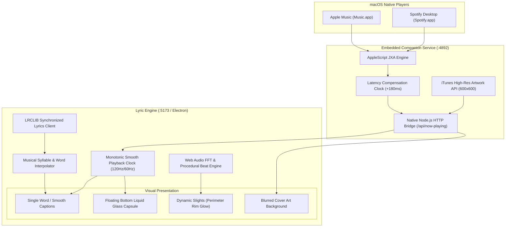

# Lyric ✦ Open-Source Ambient Rim Lighting & Kinetic Synced Lyrics

**Android port:** See [Android installation, permissions, and build instructions](docs/ANDROID.md). The default Local edition supports local audio and LRC import without notification access. Native media-session sync is available in the separate Connected edition.

<div align="center">

[](https://rithvikvatti.github.io/lyric/)
[](https://github.com/RithvikVatti/lyric/releases)
[](https://opensource.org/licenses/MIT)
[](https://github.com/RithvikVatti/lyric)
[](https://www.electronjs.org/)
[](https://react.dev/)
[](https://www.typescriptlang.org/)
[](https://tailwindcss.com/)
[](https://lrclib.net/)

**An open-source recreation and fusion of [trylumen.xyz](https://trylumen.xyz) / [trylumn.xyz](https://trylumn.xyz) (ambient screen-edge rim lighting visualizer) and [verci.xyz](https://verci.xyz) (kinetic word-by-word synchronized lyrics) for macOS, Windows, and Web with native Spotify & Apple Music support.**

[🌐 Try Web App Live](https://rithvikvatti.github.io/lyric/) • [⬇️ Download Desktop App](https://github.com/RithvikVatti/lyric/releases) • [Preview & Demo](#-preview--demo) • [Features](#-features) • [Deep Architecture](#-deep-backend-architecture-explained) • [UI & Liquid Glass](#-ui--liquid-glass-design) • [Quick Start](#-quick-start)

</div>

---

### 🚀 Try It Now
* **🌐 Web Version**: Run instantly in your browser at **[rithvikvatti.github.io/lyric](https://rithvikvatti.github.io/lyric/)** (includes demo tracks, custom audio file drop, live microphone visualizer, and global song search).
* **🍎 macOS App**: Download **[Lyric-1.0.0-arm64.dmg](https://github.com/RithvikVatti/lyric/releases)** or **[Lyric-1.0.0-mac-arm64.zip](https://github.com/RithvikVatti/lyric/releases)** for native zero-token Apple Music & Spotify desktop tracking.
* **🪟 Windows App**: Download **[Lyric-1.0.0-win.zip](https://github.com/RithvikVatti/lyric/releases)** for native Windows Spotify desktop tracking and hardware media key dispatching.

---

## 📸 Preview & Demo

<div align="center">


<p>
  <a href="./assets/preview.mp4"><strong>▶ Watch Full HD Screen Recording Demo (preview.mp4)</strong></a>
</p>

*Real-time kinetic lyrics popping to the rhythm, ambient perimeter rim lighting syncing with the audio, and dark smoked liquid glass over blurred album artwork.*

</div>

---

## 🌟 Overview

**Lyric** turns your display into an ambient visualizer and dynamic lyric display:
- **Heavily Blurred Cover Art Background**: Fullscreen dynamic background derived directly from the currently playing album artwork with gentle vignette and zero color-banding (`blur-[90px] saturate-[145%] brightness-[0.5]`).
- **Real Liquid Glass UI Elements**: Powered by [`@ybouane/liquidglass`](https://github.com/ybouane/liquidglass), rendering real-time WebGL refraction shaders, chromatic aberration, and Fresnel lighting directly onto floating HTML UI components.
- **Dynamic Slights (Ambient Perimeter Visualizer)**: Reactive screen border lighting that dynamically pulses and flares to audio sub-bass kicks, procedural rhythm envelopes, or live microphone acoustic sound.
- **Cross-Platform Zero-Token Companion Bridge**:
  - **macOS**: Communicates directly with native **Apple Music** and **Spotify** desktop apps via AppleScript/JXA with **zero logins, zero developer keys, and zero client secrets**.
  - **Windows**: Communicates directly with **Spotify** via PowerShell process inspection and WScript media key simulation with **zero OAuth setup**.
- **Two Curated Kinetic Lyric Styles**:
  1. **✦ Single Word (Verci Signature)**: Displays one massive kinetic word at a time with spring physics and upcoming ghost words preview.
  2. **Smooth Captions (Viral Pop)**: Sentence view where active words bounce out with spring scale (`scale(1.15)`) and radiant glow.
- **Monotonic 120Hz/60Hz Playback Clock**: Eliminates repeating lyrics, stutter, and lag through latency compensation and monotonic rate steering.
- **Dark Smoked Floating Capsule Player**: Sleek floating liquid glass capsule player with purely white monochrome icons, live sync calibration buttons (`−` / `+`), and zero clutter (no progress bar, no shuffle/repeat).
- **100% Self-Contained Desktop Application**: Packaged with an embedded native companion server. No terminal commands or background servers needed to launch.

---

## ✨ Features

- 🌈 **Dynamic Slights (Ambient Rim Lighting)**: Screen perimeter glow reacting live to audio FFT sub-bass (20–150Hz), automatically tinted to the current album artwork palette.
- 🎤 **Real-Time Word Sync**: Powered by the free, open-source [LRCLIB](https://lrclib.net) API with musical word and syllable timing interpolation.
- 🎵 **Native Spotify & Apple Music**: Zero-configuration local companion bridge that auto-detects currently playing songs and high-res cover art.
- 🎛️ **Floating Capsule Player Bar**: Dark smoked liquid glass pill with previous, play/pause, next, album thumbnail, track title, artist name, live sync offset widget (`Sync 0ms`), lyrics toggle, mic audio sync, and volume.
- 🎚️ **Instant Sync Calibration**: Built-in `−` and `+` buttons right on the bar (and keyboard hotkeys <kbd>[</kbd> and <kbd>]</kbd>) to delay or speed up lyrics in $50\text{ms}$ increments.
- 🎙️ **Live Acoustic & Procedural Beat Sync**: Ambient rim lights pulse to the rhythm via synchronized audio envelope modeling, plus a 1-click `Mic` toggle for real room-audio FFT analysis.
- 🖥️ **macOS Desktop App & Web App**: Run in your browser or as a native standalone Mac application with full-bleed frameless window support.

---

## 🏛️ Deep Backend Architecture Explained



### 1. Zero-Token macOS Desktop IPC (`electron/main.cjs` & `server/index.js`)

Unlike web players that require registering a Spotify Developer account and authenticating via OAuth PKCE, Lyric uses macOS's native Inter-Process Communication (AppleScript):

```javascript
// Excerpt from AppleScript JXA query
const script = `
  tell application "Music"
    set pState to player state as string
    if pState is "stopped" then return "stopped<|>none<|>none<|>none<|>0<|>0"
    set tName to name of current track
    set tArtist to artist of current track
    set tAlbum to album of current track
    set tPos to player position
    set tDur to duration of current track
    return pState & "<|>" & tName & "<|>" & tArtist & "<|>" & tAlbum & "<|>" & (tPos as string) & "<|>" & (tDur as string)
  end tell
`;
```

- **Delimited Wire Protocol (`<|>`)**: Standard AppleScript JSON serialization frequently breaks when song titles contain double quotes (`"`) or backslashes. Lyric uses custom `<|>` delimiters, making IPC string parsing 100% immune to syntax errors.
- **Embedded & Zero-Dependency**: The companion server runs directly inside Electron using Node's standard `http` library with CORS support—no separate terminal processes or external Express installations required.
- **Automatic High-Res Artwork Fetcher**: When Apple Music does not expose artwork URLs via AppleScript, the engine queries Apple's iTunes Search CDN for the official 600x600 high-resolution artwork.

### 2. The Monotonic 120Hz Playback Clock (`src/services/playbackClock.ts`)

#### Why Music Players Lag & Repeat Lyrics:
1. `osascript` takes $\sim 180\text{ms}$ to execute. When Apple Music reports `position: 12.0s`, the audio coming out of the speakers is already at $12.18\text{s}$.
2. If you poll periodically, between polls the playhead stops.
3. If an incoming sample arrives slightly late or rounded (e.g. $11.95\text{s}$ instead of $12.10\text{s}$), a naive player rewinds by $150\text{ms}$. When the clock rewinds, words that were already finished re-trigger, causing the **repeating lyric stutter**!

#### The Monotonicity Guarantee:
Lyric enforces **strict forward monotonicity**:

$$\text{currentTime}(t) \ge \text{lastReturnedTime}$$

```typescript
// Excerpt from src/services/playbackClock.ts
const currentEst = this.basePosition + (now - this.lastSyncPerfTime) / 1000;
const diff = correctedPosition - currentEst;

// If incoming is slightly behind, NEVER rewind (which causes repeating lyrics)!
if (diff > 0.05) {
  this.basePosition += diff * 0.3; // Smooth forward nudge
  this.lastSyncPerfTime = now;
} else if (diff < -0.3) {
  this.basePosition += diff * 0.15; // Gentle rate deceleration without rewinding
  this.lastSyncPerfTime = now;
}
```
Every single frame, `requestAnimationFrame` calculates position with sub-millisecond precision matching your display refresh rate (**120Hz on ProMotion MacBooks**).

### 3. Musical Word & Syllable Interpolation (`src/services/lrcParser.ts`)

LRCLIB provides millisecond-accurate timestamps at line level. To drive the kinetic single-word animation when word-level tags are not in the raw LRC file, Lyric calculates musical syllable weights:
- **Vowel weighting**: Vowels (`a, e, i, o, u, y`) are allocated 1.5x more singing duration than hard consonants.
- **Held note sustain**: The final word in each lyric line is weighted with 1.35x extra duration to match vocal sustain.
- **Punctuation pauses**: Commas, question marks, and dashes introduce natural 1.2x pauses.

---

## 🎨 UI & Liquid Glass Design

### 1. Blurred Cover Art Background
- The actual current album artwork is dynamically scaled (`scale-135`) and heavily blurred (`blur-[90px] sm:blur-[115px]`) with natural brightness (`brightness-[0.5]`) and saturation.
- You can barely distinguish the shapes, but the authentic colors, gradients, and moods of the artwork shine through naturally without muddy artificial color overlays.

### 2. Liquid Glass WebGL Shader Integration (`@ybouane/liquidglass`)
Lyric applies [ybouane/liquidglass](https://github.com/ybouane/liquidglass) WebGL refraction shaders directly onto floating HTML UI elements:
```typescript
import { LiquidGlass } from '@ybouane/liquidglass';

LiquidGlass.init({
  root: document.getElementById('root'),
  glassElements: [bottomBarRef.current],
  defaults: {
    refraction: 0.45,
    chromAberration: 0.035,
    edgeHighlight: 0.1,
    blurAmount: 0.12,
    cornerRadius: 38,
    brightness: -0.22, // Dark smoked glass profile
    opacity: 0.8,       // Transparent so blurred artwork refracts through
    floating: false
  }
});
```

### 3. Bottom Floating Capsule Player Bar
- **Pure White Monochrome Controls**: Previous (`SkipBack`), Play/Pause (`Play`/`Pause`), Next (`SkipForward`), Settings (`MoreHorizontal`), Lyrics Style toggle (`MessageSquare`), Mic toggle (`Mic`), and Volume (`Volume2`/`VolumeX`).
- **Sync Calibration Widget**: Click `−` to delay lyrics if they appear too early; click `+` to speed up lyrics if they are lagging behind.
- **Distraction Free**: No progress bar, no shuffle, and no repeat buttons to pull your attention away from the lyrics and visualizer.

---

## 🚀 Quick Start

### Prerequisites
- macOS (Apple Silicon M1/M2/M3/M4 or Intel)
- Node.js 18+ & npm

### Development Mode (Web Browser)
```bash
# Clone the repository
git clone https://github.com/your-username/lyric.git
cd lyric

# Install dependencies
npm install

# Start development server and companion bridge
npm run start
```
Visit **`http://localhost:5173`** in your browser.

### Native macOS Window (Electron)
```bash
npm run electron:dev
```

---

## 📦 Packaging for macOS

Lyric includes `electron-builder` configuration for Apple Silicon (`arm64`) and Intel:

### 1. Package Standalone Mac Application (`Lyric.app`)
```bash
npm run package:mac
```
Generates the ready-to-run `.app` bundle at `release/mac-arm64/Lyric.app`.

### 2. Generate macOS DMG Installer (`.dmg`)
```bash
npm run build:dmg
```
Generates the disk image installer at `release/Lyric-1.0.0-arm64.dmg` (~100 MB).

---

## 🌐 Publishing to GitHub

To publish this project to GitHub as an open-source repository:

### 1. Add Your Remote & Push
```bash
# 1. Add your GitHub repository as origin
git remote add origin https://github.com/your-username/lyric.git

# 2. Push main branch
git branch -M main
git push -u origin main
```

### 2. Create a GitHub Release
1. Open your repository on GitHub.
2. Go to **Releases** > **Draft a new release**.
3. Set the tag to `v1.0.0` and title to `Lyric v1.0.0 — Ambient Rim Lighting & Kinetic Synced Lyrics`.
4. Attach `release/Lyric-1.0.0-arm64.dmg` to the release binaries.
5. Click **Publish release**.

---

## 🔒 macOS Automation Permissions

When running Lyric to communicate with Apple Music or Spotify:
1. Open **macOS System Settings** > **Privacy & Security** > **Automation**.
2. Ensure **Lyric.app** (or your Terminal) has checkboxes enabled for **Music** and **Spotify**.

---

## ⌨️ Keyboard Shortcuts

| Key | Action |
|---|---|
| <kbd>Space</kbd> | Play / Pause |
| <kbd>L</kbd> | Toggle Lyric Style (Single Word ↔ Smooth Captions) |
| <kbd>[</kbd> | Delay Lyrics by $-50\text{ms}$ (use if lyrics are too early) |
| <kbd>]</kbd> | Advance Lyrics by $+50\text{ms}$ (use if lyrics are lagging) |
| <kbd>R</kbd> | Toggle Dynamic Slights (Perimeter Rim Lighting) |
| <kbd>F</kbd> | Toggle True Fullscreen |

---

## 📄 License

Distributed under the **MIT License**. See [LICENSE](LICENSE) for details.
